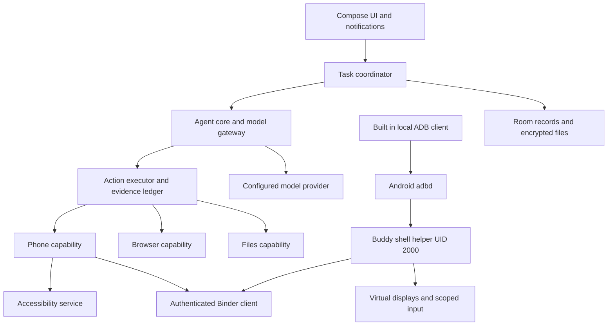

# Buddy Android Agent Product and Engineering Specification

Version 0.1 · Draft for implementation · 30 October 2026 IST

Buddy is an Android assistant that turns a natural-language request into actions across installed apps, websites, and user-selected files. Its defining experience is working on a separate virtual display while the user continues using the physical screen. The user can inspect progress, change the request, stop execution, and take over when an app requires human interaction.

Buddy includes its own wireless ADB client. The user pairs it with Android's debugging service on the same phone. That service launches a Buddy helper under the Android shell UID. The ordinary app communicates with this helper through authenticated Binder IPC. There is no external privilege-manager dependency, required computer, root requirement, or Buddy cloud backend in the initial product.

This is an implementation proposal. Requirements marked **MUST** are release conditions; **SHOULD** permits a documented exception; **MAY** indicates optional scope. Performance numbers are engineering targets to validate, not measured results. Public SDK capabilities, privileged AOSP interfaces, and product choices are identified separately. Reference numbers resolve to official sources in section 30.

## Contents

1. Product decisions
2. Users and outcomes
3. Scope and delivery boundaries
4. Platform support and distribution
5. Product requirements
6. Experience principles and design research
7. Information architecture
8. Visual system and components
9. Screen specifications
10. Interaction flows and copy
11. Accessibility and adaptive behavior
12. System architecture
13. Wireless ADB pairing and connection
14. Privileged helper and IPC
15. Virtual displays and focus
16. Observation and app actions
17. Agent runtime and tools
18. Approvals and human takeover
19. Browser capability
20. Files and optional compute
21. Memory and app knowledge
22. Scheduling and background execution
23. Storage and privacy
24. Android API inventory
25. Permissions and manifest requirements
26. Reliability and resource management
27. Performance and quality targets
28. Verification and acceptance
29. Delivery plan and decisions
30. Official references

# 1 Product decisions

| Decision | Buddy requirement |
| --- | --- |
| Primary platform | Android; phone control requires Android 13 or newer, with Android 14 or newer recommended. |
| Privileged access | Built-in, locally paired wireless ADB client launching Buddy's own shell helper. |
| Agent implementation | Kotlin and coroutines, with a platform-independent JVM core. No embedded JavaScript engine is required for the agent loop. |
| App control | Read accessibility windows for the selected display; use semantic node actions or display-targeted input; use OCR and optional model vision when necessary. |
| Default execution surface | Buddy's virtual display. Never silently fall back to controlling the user's physical screen. |
| Model hosting | Bring your own model API endpoint and key; direct phone-to-provider connection. Support local-network endpoints explicitly. |
| Default autonomy | Read and navigate within the requested task; approve consequential external actions individually. Purchases and financial authentication require human takeover. |
| Initial concurrency | One active phone-control run; queue others. Later allow two on qualified devices, with a hard product cap of three. |
| Distribution | Signed direct-download APK for the full autonomous agent. A Play Store edition is a separate product and policy decision. |
| Primary specification | This root `spec.md`; README links here. |
| iOS | Outside scope; there is no supported equivalent of this local ADB helper architecture on ordinary iPhones. |

# 2 Users and outcomes

The initial audience is Android users comfortable following a guided Developer options setup who want help with repetitive app work, research, or organizing information. Buddy should remain understandable after that setup; everyday use must not require knowledge of ADB, display IDs, tokens, or accessibility trees.

Representative jobs:

- Read a selected group conversation and summarize today's discussion with evidence.
- Find information in an installed app and organize it into a note or file.
- Research a question across websites, compare findings, and link sources.
- Prepare a message in a selected app, show the recipient and text, and send after approval.
- Prepare a shopping cart, then hand control to the user for the purchase.
- Run a recurring, bounded information check and notify only when its condition is satisfied.

Success means the requested outcome is supported by observations, the user understands what happened, and the physical screen remains usable. A plausible final answer without evidence of an executed action is not success.

# 3 Scope and delivery boundaries

## 3.1 Initial release

The initial release includes pairing and connection recovery; one virtual display; accessibility, OCR, coordinate taps, scrolling, text entry, and app launch; a tool-calling model; chat and task history; live preview; cancellation; approvals; takeover; local encrypted secrets; local run records; evidence-backed results; and a capability diagnostics page.

An embedded browser and user-selected file import/export follow after the phone-control release gate. Core architecture must accommodate them without coupling them to the phone helper.

## 3.2 Subsequent releases

Scheduled information checks, opt-in memory, app knowledge packs, qualified parallel phone runs, and optional local compute are later phases with their own acceptance gates. They are described here so interfaces and data models support them; they are not prerequisites for the first phone-control beta.

## 3.3 Exclusions

Buddy does not root devices, bypass secure windows, solve CAPTCHAs, bypass app access controls, silently unlock the phone, provide guaranteed operation in every app, or promise automatic restart under every OEM power manager. It does not provide an unrestricted model-accessible shell running with shell privileges. Support for work profiles, cloned apps, remote device control, arbitrary MCP servers, voice wake words, and executing downloaded plugins is deferred.

# 4 Platform support and distribution

## 4.1 Compatibility contract

| Environment | Product behavior |
| --- | --- |
| Android 13, API 33 | Eligible for phone-control beta only after capability checks; warn that focus isolation may be limited. If focus isolation fails but the virtual display itself works, require an explicit exclusive-control session rather than simultaneous use. |
| Android 14 to 16, API 34 to 36 | Primary qualification range; test independent display focus, keyboard routing, task launch, screenshots, and helper recovery on real devices. |
| Newer Android releases | Experimental until the same qualification suite passes; an SDK version alone never proves hidden-interface compatibility. |
| Non-arm64 architecture | Chat/browser support is possible; initial phone-control APK and native pairing implementation ship arm64-v8a. An x86_64 development artifact is separate. |
| OEM restrictions or managed device | Explain the specific missing capability; keep available features usable. Do not claim that shell UID overrides device policy or SELinux. |

Start with compileSdk/targetSdk 36 as a reproducible Android 16 baseline and re-evaluate the latest stable SDK and distribution requirements at implementation kickoff. Do not pin preview SDKs merely because reference pages mention newer APIs. Pin the chosen SDK, NDK, Kotlin, AGP, Compose BOM, and native dependency revisions in the build manifest.

`DisplayManager.createVirtualDisplay()` dates to API 19. Display-specific gestures and cross-display accessibility windows date to API 30. Android 13 is Buddy's chosen support floor, not the introduction date of virtual displays. [1–6]

## 4.2 Distribution constraint

Google Play's current AccessibilityService policy prohibits using the API to autonomously initiate, plan, and execute actions or decisions, apart from qualifying verified accessibility tools serving people with disabilities. A general assistant must not label itself an accessibility tool merely to obtain that exemption. Deterministic, human-defined scripts have different policy treatment. [23]

The full Buddy agent therefore launches through a signed direct APK channel. This does not exempt it from Android permissions, app terms, privacy obligations, or secure-window restrictions. A future Play edition must receive a separate feature and policy review; adding confirmation cards alone does not establish eligibility. Do not promise Play availability in product copy.

APK updates must be signed with the same protected release key, published with SHA-256 checksums and release notes, and installed through Android's user-confirmed package installer. No self-modifying downloaded privileged code.

# 5 Product requirements

| ID | Requirement | Release acceptance |
| --- | --- | --- |
| BUD-01 | Accept a text request, attachments, and a clarification within one conversation. | New text reaches the run before its next action; prior completed actions remain recorded. |
| BUD-02 | Configure and test a model with tool calling. | Test a harmless synthetic tool call; distinguish authentication, endpoint, rate-limit, and unsupported-tool errors. |
| BUD-03 | Pair locally without a computer. | Complete code pairing, authenticated transport, helper handshake, and a harmless display/input probe. |
| BUD-04 | Work on a background display. | Open an approved test app there, read it, enter text, and verify the physical screen receives no agent input. |
| BUD-05 | Show actual progress. | Display current app, current bounded action, live or explicitly stale preview, and an expandable action log. |
| BUD-06 | Stop predictably. | Stop prevents the next dispatch; an already-dispatched action may finish and must be reported. |
| BUD-07 | Approve consequential actions. | Recipient, payload, target, and applicable price are visible; approval is invalidated by relevant screen changes. |
| BUD-08 | Hand an app to the user and resume. | Move the existing task, retain state, then reobserve before any resumed action. |
| BUD-09 | Report truthful outcomes. | Each run ends as Done, Partial, Blocked, Cancelled, Interrupted, or Unknown with supporting observations. |
| BUD-10 | Protect private data. | A local privacy gate filters structured text and image pixels before preview, OCR, persistence, or model use; uncertain credential/protected surfaces are suppressed. Keys and pairing credentials never enter model context or logs. |
| BUD-11 | Recover after interruption. | Mark interrupted runs; never automatically replay an uncertain send, deletion, or purchase. |
| BUD-12 | Make permissions reversible. | Disconnect stops the helper and explains how to remove Android's paired debugging identity. |
| BUD-13 | Retain control across navigation. | Back or Home leaves the run active only when an approved, reachable control surface is available; otherwise phone control pauses. Explicit Stop ends it. Notification opens the correct run. |
| BUD-14 | Respect locked state. | Check physical-device lock and interactive state before each app action, regardless of virtual-display flags. |

Later requirements: BUD-15 browser sessions and evidence; BUD-16 scoped file handling; BUD-17 opt-in memory; BUD-18 bounded schedules; BUD-19 qualified concurrency; BUD-20 optional isolated compute. Each must pass section 28 before release.

# 6 Experience principles and design research

## 6.1 Design direction

Use native Jetpack Compose with Material 3 and selectively adopt Material 3 Expressive components and motion. Official Compose guidance describes Expressive as an evolution of Material 3 across shape, typography, motion, and theming, including dynamic color. Some APIs remain experimental; wrap those behind Buddy components and use stable equivalents when needed. [25]

Buddy's visual character is warm, quiet, and competent. Expressiveness belongs in the primary action, clear typography, meaningful state transitions, and an optional modest identity mark. Dense gradients, glass blur over live screenshots, perpetual mascot motion, and decorative dashboards reduce the legibility needed for supervision.

## 6.2 Research translated into product decisions

| Official guidance | Buddy design consequence | Validation |
| --- | --- | --- |
| Material 3 theming and Expressive [25] | Semantic color roles, rounded grouped surfaces, strong action hierarchy, restrained responsive motion. | Light/dark/dynamic-color comparison; consistent component states. |
| Adaptive app and navigation guidance [26–27] | Bottom navigation on compact windows, rail on larger windows, conversation plus inspector when space permits. | Resize and fold without losing draft, selection, or run identity. |
| Compose accessibility defaults [28] | At least 48 dp touch targets, useful semantics, distinct labels, readable large text. | TalkBack, Switch Access, 200% font scale, keyboard navigation. |
| System bars and notification guidance [29–30] | Edge-to-edge surfaces with safe insets; task notification carries meaningful state and direct actions. | Gesture and three-button navigation; privacy on locked screen. |
| Material progress components [31] | Indeterminate work indicator when duration is unknown; real step counts only when grounded. | Users distinguish loading, active work, waiting, and blocked states. |
| Bottom sheet guidance [32] | Sheets for contextual controls; critical approval remains a persistent card, not a transient sheet. | Dismissal never approves, cancels, or loses a pending decision. |

These are design decisions informed by official guidance, not claims of a tested Buddy usability study. Before general release, test setup, approval comprehension, cancellation, and takeover with 5–8 representative users, including users of assistive technology. Repeat after material failures; recruit for varied technical confidence and Android OEMs.

## 6.3 User control

The user must always be able to identify what Buddy is doing, where it is doing it, what it has already changed, and whether it needs attention. Task progress uses concise activity statements such as “Reading the conversation” or “Checking the saved note.” Never expose model chain-of-thought; the inspector shows tool actions and observed results.

Uncertainty is concrete: “I tapped Save, but could not confirm that the note was saved.” Avoid claims such as “Almost done” when no measurable completion estimate exists. Do not display a fabricated percentage or countdown.

# 7 Information architecture

Four primary destinations:

1. **Chat:** conversations, composer, active task, results.
2. **Activity:** all running, waiting, queued, and completed tasks, searchable history, and per-run inspector.
3. **Automations:** scheduled tasks and rule history; hide until the scheduling phase ships.
4. **Settings:** Phone connection, Models, Permissions, Privacy, Memory, Files, Appearance, Diagnostics, and About.

Phone connection and model status appear as a compact status row in Chat. A connection fault never opens a modal automatically. Tapping it opens the relevant repair step. A browser becomes a secondary destination from Chat and Settings when available; it does not displace the main task interface.

Task details use three views: **Summary**, **Steps**, and **Preview**. The preview is observational by default. Raw taps into it require explicit manual-control mode and suspend agent writes.

# 8 Visual system and components

## 8.1 Proposed tokens

| Token | Proposed value or rule |
| --- | --- |
| Color | Material semantic roles; seeded indigo `#4F46E5` when dynamic color is off. Generate tonal palettes; never assume a seed is readable on every surface. |
| Themes | System-following light/dark by default; explicit override; dynamic color opt-in during appearance setup. |
| State colors | Primary for active; amber family for attention; error for failure; green family for confirmed completion. Every state also has text and an icon. |
| Typography | System sans-serif using Material type roles; body 16 sp, supporting text 14 sp, major title 28–32 sp. Scale with system settings. |
| Spacing | 4 dp base; 8/12 dp related content; 16 dp screen margin; 24 dp section separation; 32 dp major separation. |
| Shape | 12 dp compact containers; 20 dp task/approval cards; pill shape for chips and composer. Preserve visible input boundaries. |
| Controls | Minimum 48 × 48 dp interactive area; primary buttons about 52–56 dp high. Do not enlarge icon touch areas into adjacent actions. |
| Motion | Proposed 150–250 ms local transitions and 250–350 ms pane changes; platform animation preferences win. No bounce on approval or error. |
| Readability | Target WCAG AA contrast: 4.5:1 normal text, 3:1 large text and essential non-text controls. Validate generated palettes and disabled states separately. |
| Icons | Material Symbols or a consistent equivalent, with labels for primary navigation and important actions. |

These values are Buddy design tokens, not mandatory sizes specified by Android. Use typography roles instead of locking every screen to pixels.

## 8.2 Component library

Implement `BuddyScaffold`, `ConnectionStatusChip`, `TaskStatusCard`, `LivePreview`, `ActionRow`, `ApprovalCard`, `TakeoverCard`, `EvidenceCard`, `ModelPicker`, `AttachmentChip`, `ErrorRecoveryCard`, and `UsageSummary`. Each has loading, active, disabled, error, empty, dark, large-text, and accessibility states where applicable.

`TaskStatusCard` contains: state label, current action, app/site name, elapsed time, optional small preview, and **Pause**, **Stop**, and **View steps**. Pause means suspend before the next action; label “Pausing…” while one action is in flight. Stop is immediately available without an extra confirmation. A secondary menu contains detailed diagnostics.

`LivePreview` shows app name, capture timestamp, and “Live,” “Paused,” or “Preview unavailable.” A frozen image must never keep a Live label. Hide the image when the target is protected or sensitive; explain why. Do not stream screenshots to the model solely to animate the UI.

`ApprovalCard` uses explicit verbs: “Send message,” “Delete these 3 files,” or “Submit form.” Generic “OK” is insufficient. Show recipient, final text, destination, amount/currency when relevant, and one-time scope. Approval and denial are separate, adequately spaced controls; dismissing or navigating away preserves the pending decision.

# 9 Screen specifications

## 9.1 Welcome and capabilities

Explain the value with one short example and a static illustration of a phone screen plus Buddy's background workspace. Primary action: **Set up Buddy**. Secondary: **Try chat first**. State that the model provider may receive task-relevant screen content. No permission requests on first paint.

## 9.2 Setup checklist

Checklist rows: **Choose a model**, **Connect phone control**, **Allow screen access**, **Run a quick test**. Each row reports Not started, In progress, Ready, or Needs help. The checklist saves progress, permits Back, and keeps chat usable. A user can configure the model before or after phone pairing.

The connection wizard has one instruction per screen, a screenshot-style local illustration, **Open settings**, **I've done this**, and **Do this later**. Readable system state can auto-complete a step, but an unreliable OEM setting read must not block the user's manually confirmed progression.

## 9.3 Model setup

Fields: provider preset, endpoint, API key, model picker. Optional separate vision and lightweight models sit under Advanced. Explain “Your requests go directly to this provider.” Endpoint testing must distinguish successful reachability from verified tool calling. The initial release accepts HTTPS endpoints, including supported local-network HTTPS servers. Plain HTTP local-model support is deferred until a separate network policy and release configuration are reviewed; an ordinary consent checkbox cannot override Android's cleartext-traffic policy. Do not silently disable certificate checks for local servers. [36]

Show a masked key, visibility toggle, Test connection button, and actionable error. Never include actual API keys in screenshots, logs, or exception strings. Store authentication only after successful validation or an explicit Save anyway action with a visible Unverified label.

## 9.4 Chat home

An empty conversation shows a short greeting, 3–4 example task chips, and connection/model status. A persistent bottom composer supports text, attachments, provider selection, and Send. Voice input may use the user's keyboard; custom microphone capture is deferred.

When a task starts, insert its status card into the conversation and keep it reachable above the composer. New user messages remain visible and say “Added to this task” once consumed. If a run is paused awaiting an approval, a new message invalidates the old proposal when its meaning changes.

Example compact layout:

```text
Buddy                         New chat
Phone ready · Model connected

You: Summarize today's project chat

Working in Messages            00:24
Reading earlier messages
[ background screen preview ]
[Pause] [Stop]       View steps

[ + ] Add a detail…         [Send]
Chat       Activity       Settings
```

## 9.5 Activity and task inspector

Group items by **Needs you**, **Running**, **Queued**, and **Recent**. A badge counts unresolved attention requests, not all unread log entries. Each row includes task title, app/site, last meaningful action, and state.

The inspector shows a chronological, paginated list of observed actions: what was requested, target, result, timestamp, and optional redacted evidence. Collapsed rows use plain language; technical IDs and timings are expandable. Do not call a successful input dispatch a successful user outcome.

## 9.6 Approval and takeover

Approval stays in Chat and Activity until answered or invalidated. A notification deep-links to the exact pending decision; consequential approvals occur in Buddy's contextual decision view. The initial product does not offer financial-action approval: orders, payments, and transfers always use human takeover. Optional `BiometricPrompt` or device credential authentication may protect supported high-impact nonfinancial decisions, without replacing the recipient/payload preview.

Takeover has explicit states: **Buddy needs you**, **You're in control**, and **Checking your changes**. Buttons: **I'll handle it**, **I've finished**, **I completed the whole task**, and **Cancel task**. Moving the app to the physical screen occurs only after the user's action. Closing the card does not imply completion.

## 9.7 Completion

Show the result first, followed by sources or artifacts and a compact “What Buddy did” summary. Distinguish “Sent,” “Drafted,” and “Could not verify sending.” Show partial results with the remaining step and a focused recovery action. Token and cost details live in a secondary disclosure, with cost labeled estimated unless verified against a configured price table.

## 9.8 Connection and diagnostics

Display four independent statuses: Paired identity, Debugging connection, Helper, Screen access. “Ready” requires a live helper plus necessary capabilities; persisted pairing alone is not Ready. Include Reconnect, Run connection test, Stop helper, Forget local pairing, and setup help. Diagnostics expose reason codes and non-sensitive capability results, never pairing secrets.

## 9.9 Automations and privacy

An automation card shows its rule, next expected execution in the user's timezone, last outcome, and pause switch. Edit view previews the next three execution times and explains approximate scheduling. Privacy shows provider destinations, memory items, screenshot retention, per-app exclusions, export/delete controls, and a global **Pause phone control** switch.

# 10 Interaction flows and copy

## 10.1 Pairing flow

1. Explain: “Buddy connects to Android's debugging service on this phone to enable background app control.” Link a technical explanation.
2. Guide the user to Developer options and Wireless debugging. Do not require USB debugging as a protocol prerequisite; OEM-specific instructions may mention it only when verified necessary. [10–11]
3. Ask the user to open **Pair device with pairing code** and keep that dialog open.
4. Offer a notification with a RemoteInput action to enter the six-digit code while Settings remains open. If notifications are denied, use split-screen instructions or a manual address/port and code form without claiming the dialog survives switching apps.
5. Label **pairing port** and **connection port** distinctly. A six-digit code is not the connection port. Normalize spaces/full-width digits; reject invalid codes locally.
6. Pair, discover the separate connection service, establish authenticated TLS, launch the helper, and run the test. Show these stages without a false percentage.
7. Confirm: “Phone control is ready.” If only pairing succeeded, say “Paired. Finish connecting” instead.

Never automatically read the pairing code from unrelated screen content in the initial release. Any future setup assistance must be limited to this user-initiated system dialog and disclosed.

## 10.2 Recovery copy

| Condition | Message | Action |
| --- | --- | --- |
| Code expired | “The pairing code expired. Open a new code and try again.” | Enter new code |
| Wi-Fi disconnected | “Android turned off wireless debugging after the network changed.” | Open wireless debugging |
| Authorization revoked | “Android no longer recognizes Buddy's pairing.” | Pair again |
| Accessibility unavailable | “Buddy can't read app controls yet.” | Open screen access setup |
| Display creation unsupported | “This phone couldn't create Buddy's background screen.” | Disable phone control and show compatibility details; chat/browser remain available |
| Focus isolation unsupported | “Buddy's screen works, but typing may interrupt your keyboard.” | Offer qualified exclusive-control mode with clear consent |
| User using target app | “You're using this app. Buddy will wait until you're finished.” | Wait / Choose another task |
| Protected page | “This page hides its contents from screen capture. Please handle this step.” | I'll handle it |
| Unknown action result | “The connection stopped after the action. Check the app before retrying.” | Inspect result |

## 10.3 Interruptions and background use

Back closes a sheet, exits an inspector, or returns to the previous destination; it does not cancel a run. Home leaves work running where permitted. Stop cancels queued actions and model calls and produces a record of completed and uncertain actions. A task notification includes state and Stop; lockscreen text is generic by default.

If notifications are denied, the initial release is **foreground-supervised** for phone actions: leaving Buddy's visible task UI pauses new dispatches at the next safe boundary. An in-flight action may settle and is reported on return. Explain “Keep Buddy open, or allow notifications to supervise work in the background.” Pending approvals remain in Chat/Activity. Android's foreground-service task-manager indicator alone is not the promised readily accessible Stop control. An overlay-based alternative requires its own tested, explicitly accepted control contract in a later release; notification denial does not silently enable an overlay.

The optional floating pill is opt-in and appears only for an active run or attention request. One tap opens the compact task card. Double-tap may offer **Ask about this screen**, but never automatically uploads the main screen. Main-screen capture requires a visible user action and a preview/consent flow. The pill must not cover system permission dialogs, payment controls, keyboard input, or essential navigation.

## 10.4 State presentation matrix

| Runtime state | Chat and Activity | Background surface | Allowed response |
| --- | --- | --- | --- |
| Queued | Position and reason, such as app in use | Aggregate queue count when useful | Edit request / Cancel |
| Pausing | “Finishing the current action before pausing” | Pausing, with Stop | Stop; no promise of rollback |
| Paused | Last confirmed action and reason | Paused | Resume after reobservation / Stop |
| Approval expired | Expired card, no active approval button | Open Buddy to review again | Rebuild proposal from fresh evidence |
| Takeover movement failed | Explain that the app was not moved | Needs you; open recovery | Retry qualified move / Manual handoff / Cancel |
| Cancelled with uncertain effect | “Stopped. This action may already have happened.” | Attention summary | Inspect result; no automatic retry |
| Notifications denied | Foreground-supervised label | No assumed notification control | Pause on leaving; enable notifications explicitly |
| Exclusive-control mode | Persistent banner: “Let Buddy finish before using the phone” | State and Stop if available | Pause / Stop; never imply concurrent typing |

Exclusive-control mode still operates on a functioning Buddy virtual display. It is not a fallback to physical-screen automation. Users must knowingly pause physical interaction; if that condition cannot be maintained or input routing is unsafe, disable phone control on the device. A display-creation failure has no exclusive-mode fallback.

# 11 Accessibility and adaptive behavior

Use Material 3 Adaptive's `currentWindowAdaptiveInfo()` and `NavigationSuiteScaffold` rather than inferring layout from device model. Compact windows use one pane; medium windows use a rail where practical; expanded windows show conversation and task inspector together with a comfortable reading width. Fold hinges are occlusions, not content areas. [26–27]

Preserve selection, draft text, scroll position, task subscription, and preview ownership through resize and rotation. A change in UI layout must not recreate the helper or silently restart an action. Use edge-to-edge rendering with `WindowInsets`, safe drawing areas, and IME insets; `enableEdgeToEdge()` provides compatible setup. Support predictive Back without intercepting all back gestures. [29,33]

All actionable elements have a readable name and role. Task state changes use concise, throttled accessibility announcements; do not announce every screenshot or streamed token. TalkBack focus must not jump on each agent update. Expose running/waiting/completed states with semantics, not color alone. Ensure Stop and Reject remain reachable at 200% font scale, in landscape, and with Switch Access. Offer static progress visuals when animations are disabled. Validate compatibility with an active screen reader before enabling gesture fallbacks.

# 12 System architecture



## 12.1 Proposed modules

| Module | Responsibility |
| --- | --- |
| `:app` | Compose navigation, onboarding, permission flows, notifications, foreground task service, dependency injection. |
| `:core` | Pure Kotlin run contracts, model loop, tool registry, policies, evidence, budgets, context compression, scheduling logic. |
| `:adb` | Discovery, pairing lifecycle, TLS transport, ADB framing, connection recovery; no agent tools. |
| `:pairing-native` | Audited AOSP-compatible pairing/authentication primitives and JNI boundary, with pinned source revisions. |
| `:shell-api` | AIDL interfaces, versioned parcelables, reason codes, capability negotiation. |
| `:shell-helper` | `app_process` entry point, authenticated handoff, privileged display/task/input operations and cleanup. |
| `:phone` | Per-run display sessions, accessibility observation, OCR, target matching, post-action verification. |
| `:browser` | Embedded browser host, controlled interactions, sessions, downloads, handover. |
| `:storage` | Room, Keystore-backed encryption, attachments, retention and export. |
| `:designsystem` | Buddy components, theme tokens, previews and semantics. |

The core depends on capability interfaces, never Android classes. Capabilities do not directly invoke one another. The assembly layer supplies implementations. All effects enter one action executor even when requested through a batch, script, or future integration.

## 12.2 Process boundaries

The ordinary app UID owns UI, networking, private credentials, policy decisions, and the accessibility service bound by Android. A separate shell process owns privileged objects. `app_process` alone does not grant shell privileges; the authorized `adbd` execution context does. Keep the helper small and free of model/network dependencies.

Use a foreground service for a user-visible active task where Android permits it, not a permanent idle service solely to claim process immortality. A helper can survive a lost ADB transport; its Binder death and lease state determine actual readiness. No long-running app subprocess per action.

# 13 Wireless ADB pairing and connection

## 13.1 Protocol

Wireless debugging uses code-based pairing and a separate TLS connection service. Implement the AOSP protocol, not legacy unauthenticated TCP/5555. Pairing uses AOSP's SPAKE2-based authenticated exchange with TLS-derived material and peer-information exchange; subsequent ADB transport uses Buddy's paired client identity and STLS/TLS negotiation. Use reviewed native primitives and interoperability tests against official platform-tools; do not invent cryptography. [10–12]

Distinguish three properties: pairing authenticates the exchange using the displayed secret; the daemon subsequently authorizes Buddy's registered client key; and TLS encrypts the transport. Stock AOSP's host-side transport accepts the server certificate and does not supply conventional CA verification or a paired-server certificate pin. Do not claim mutual server identity verification merely because AOSP compatibility succeeds. Buddy's initial transport is loopback-only, and readiness additionally requires the nonce-bound Binder handshake from the real shell UID. Hardening beyond AOSP requires a separately designed, interoperable mechanism, not an invented check against a GUID. [37]

Service types:

```text
_adb-tls-pairing._tcp  Pairing service while the code dialog is open
_adb-tls-connect._tcp  Authenticated debugging transport
```

Use `NsdManager` to discover candidate ports. A local ADB client does not require running the desktop ADB server on port 5037. In the initial release, the phone connects only to `127.0.0.1` at a changing port; no Wi-Fi interface address, remote host, proxy, or hostname supplied by a model is accepted for ADB. If loopback is unsupported on a device, mark that configuration unsupported and offer diagnostics. Wi-Fi is commonly required to enable the system feature even though local traffic need not leave the device.

## 13.2 Endpoint selection

Try, in order: last successful loopback connection port; best-effort readable system hint; mDNS candidate ports tested on loopback; user-entered current connection port on loopback. Port hints are untrusted suggestions, not proof of an ADB service. A bounded scan of local ephemeral ports is an optional diagnostics fallback, off by default; it must never scan other devices or the broader subnet. Validate the ADB/TLS exchange and only issue the fixed bootstrap command; no general tool action is allowed before the shell-UID Binder handshake succeeds.

Pairing candidates must resolve to the loopback service on this phone. Do not connect to another advertised Android device simply because it is on the same Wi-Fi. A discovery instance name or advertised GUID is a routing hint, not cryptographic proof of server identity. A local malicious listener cannot satisfy the required real-shell-UID Binder bootstrap without equivalent elevated privileges; the app must reject fake or missing handoff. Connection authorization failure stops retries and offers repair; it is not a reason to try arbitrary ports repeatedly.

## 13.3 Credential handling

Generate a dedicated ADB client identity for Buddy. Prefer a Keystore-backed private key if the selected TLS stack can use a non-exportable key through a tested signing adapter. If native TLS requires key bytes, store the serialized identity encrypted by a Keystore-held AES-GCM key in `noBackupFilesDir`, decrypt only for a bounded transport lifetime, and document that it is not hardware-non-exportable. Retain pairing GUID/metadata for reconnection without treating it as a server-certificate pin. AOSP client authorization and local helper authentication are separate checks.

Never persist pairing codes, passphrases, or native debug dumps. Disable backup for pairing credentials and model keys. Local identity deletion does not remove Android's trusted public-key entry: guide the user to Wireless debugging → Paired devices → Buddy → Forget. A security incident may require revoking the system entry, not just clearing app storage. [18]

## 13.4 Connection state machine

```text
Unconfigured -> AwaitingSystemSetup -> DiscoveringPairing -> Pairing
 -> PairedDisconnected -> DiscoveringConnection -> ConnectingTLS
 -> StartingHelper -> AuthenticatingHelper -> CheckingCapabilities -> Ready

Ready -> HelperLost -> Reconnecting -> Ready
Any active state -> AuthorizationRevoked -> NeedsPairing
Ready -> UserDisconnected -> Stopped
```

Pairing, transport, helper, and accessibility readiness are separate persisted/observed states. App relaunch must probe the existing helper before starting another one. A paired key may remain valid after reboot even though debugging is disabled and the helper is gone.

Retries are cancellable, bounded, and use jittered backoff. Proposed reconnection attempts: immediate, 1, 2, 4, and 8 seconds, then a visible recovery state. A network callback may trigger a new bounded attempt after a genuine connectivity change. Never launch repeated system permission prompts or a port scan loop.

## 13.5 Reboot and opt-in repair

The baseline release guides the user to re-enable wireless debugging after reboot or a network change. It does not promise zero-touch repair. Optional advanced recovery may use an explicitly granted ability to modify the relevant secure/global setting, obtained during an authorized shell session and verified on that OS build. `WRITE_SETTINGS` alone is not a general grant to change `Settings.Global`; privileged permissions and OEM behavior must be tested.

Never keep fighting a user's disabled accessibility service or debugging toggle. Honor Buddy's pause/disconnect state and observed explicit revocation. Re-enable any system service only under a separately explained opt-in repair setting and supported authorization. No root fallback.

Switching off wireless debugging or forgetting the ADB identity does not inherently kill a helper that Android already launched. **Buddy Disconnect** is the immediate product-level revocation control: cancel runs, revoke leases, destroy the helper, close transport, clear local identity if requested, and explain separate system pairing removal. Observe debugging-setting changes where supported and stop lease renewal when the user disables access. A failed or unreadable required state check pauses phone control rather than assuming authorization persists.

Proposed active leases last at most 30 seconds and renew every 10 seconds; the helper independently expires them. Revalidate daemon authorization through a fresh bounded connection during active phone control, starting early enough to finish before the existing 30-second freshness deadline, and stop on authorization rejection. A successful TLS handshake alone is insufficient: send a new one-time nonce only through that fresh transport to a fixed packaged revalidation entry point, and require the nonce to return through an actual UID-2000 Binder callback to the app's authenticated bootstrap endpoint. The already-running helper's heartbeat or existing Binder session cannot satisfy this proof. Revalidation must force a new client-authorization decision, not reuse a pooled transport or a resumed TLS session that skips the required check; prove this against Android's Forget action in M0.

Only that complete proof updates the authorization timestamp. The effective expiry is the earlier of the lease deadline and the last successful authorization proof plus 30 seconds; renewal cannot extend the authorization-freshness deadline. Reject new input when either deadline expires. If a stale loopback listener accepts TLS but cannot execute the real shell callback, revalidation fails closed. M0 must prove revocation detection and its measured bound on each supported build; if the proof or fresh client authorization cannot be established, treat it as a release blocker rather than claiming the bound. Explain that OS pairing removal does not intrinsically kill an existing helper and require Buddy Disconnect for immediate termination. An unexpected network loss may pause control under this policy even if Binder remains alive.

# 14 Privileged helper and IPC

## 14.1 Launch and handoff

Resolve the installed, signed APK path through package APIs. Launch a packaged, versioned helper entry point with an authorized ADB execution service. Illustrative command structure:

```text
CLASSPATH=<installed-base.apk> app_process /system/bin \
  --nice-name=<applicationId>:helper <helper.main.Class> \
  <applicationId> <expectedAppUid> <signingCertificateDigest>
```

The production launcher must quote every argument and never construct commands from model output. Send a cryptographically random one-time handoff nonce over stdin rather than argv, then close the input channel. Keep the execution channel alive until the helper acknowledges launch and verify the helper survives intentional transport closure on each supported OS. Detached lifecycle is a tested implementation detail, not a consequence of the command name.

The helper must verify its observed UID is 2000 and reject startup otherwise. Resolve split-APK/classpath requirements explicitly; package the entry point so it can load all required classes and native libraries from the installed artifact. The helper does not inherit the app's private-data access or obtain its model keys. Keep privileged adapters independent of app-private storage.

Create a tested shell-attributed system-service context/Binder adapter. The package/attribution identity passed to DisplayManager and other services must belong to UID 2000, typically `com.android.shell`, rather than pretending Buddy's application package belongs to shell. DisplayManagerService validates package ownership independently of display-flag permissions. Check the calling identity at every service boundary, validate Buddy's caller first, and only then clear to the helper's own identity for the privileged operation. M0 must test the signed production packaging, shell manifest grants, package attribution, and cleanup—not only commands run in an interactive developer shell. [38–39]

Use a narrowly exposed ContentProvider handoff or equivalent Android Binder bootstrap. The app verifies the actual Binder calling UID is shell UID 2000, the pending nonce matches, the launched helper version is expected, and the handoff is unused and unexpired. The helper independently resolves the target package UID and signing digest before delivering its Binder. A claim inside a parcel is never proof of identity. Explicitly disable unsupported root UID handoffs in the initial release.

After handoff, every helper transaction checks `Binder.getCallingUid()` against the authorized app UID before any `clearCallingIdentity()`. Protocol version, capability list, random session lease, request ID, and monotonic deadline are negotiated. Nonces are one-time; lease renewal and reconnect use fresh challenges. Package reinstall or signing mismatch terminates the helper and restores tracked changes. Cache a bounded set of request IDs and dispatch acknowledgements within each helper instance so a transport retry cannot automatically dispatch the same effect twice; loss of that cache is uncertainty, not permission to replay. [13]

This authenticates Buddy against ordinary unauthorized apps. A compromised OS, root process, or another fully authorized ADB shell client is outside that isolation boundary; they may have equivalent system privileges. Do not describe the helper as a security boundary against an attacker already controlling the debugging service. Limit the exposed provider to the bootstrap method, reject all other CRUD/call paths, rate-limit failures, and avoid model-controlled exported intents.

## 14.2 Narrow interface

```kotlin
interface BuddyShellContract {
    fun capabilities(): HelperCapabilities
    fun createDisplay(spec: AgentDisplaySpec): DisplayHandle
    fun releaseDisplay(handle: DisplayHandle)
    fun launchApp(handle: DisplayHandle, target: AppTarget): LaunchResult
    fun listTasks(handle: DisplayHandle): List<TaskSummary>
    fun injectGesture(handle: DisplayHandle, gesture: GestureSpec): ActionResult
    fun injectKey(handle: DisplayHandle, key: AllowedKey): ActionResult
    fun moveTaskForTakeover(token: TakeoverToken): MoveResult
    fun releaseLease(leaseId: String)
}
```

This is a logical contract; use bounded AIDL parcelables and explicit errors in implementation. `DisplayHandle` combines helper instance, lease, logical display ID, and a random ownership token. A guessed numeric display ID is insufficient authorization.

Do not provide `exec(arbitraryString)` to the model or normal UI. Implement fixed typed operations for task launch, settings changes, permitted keys, and recovery. If a fixed shell-command fallback is necessary, allowlist the operation, validate all arguments, set a timeout, cap output, and record the fallback. No model-supplied paths, URIs, or strings may become shell syntax.

## 14.3 Ownership and cleanup

The helper only injects into displays it owns for a live lease. Moving a task to or from the physical display requires a short-lived takeover authorization tied to the specific task. Reject arbitrary main-display injection. Validate coordinates, gesture duration, pointer count, and event count. Bound payloads and keep image data out of Binder's transaction-size limit by passing `Surface` handles or file descriptors.

On app Binder death: cancel dispatch, restore tracked app audio/clipboard changes, and release agent displays and task leases. The helper may remain inert briefly to accept an authenticated reconnection, with a bounded idle timeout; it must not keep controlling apps after the app loses control. Register `linkToDeath`, handle `DeadObjectException`, and prevent duplicate helpers by an authenticated instance/lease protocol rather than killing arbitrary `app_process` processes.

# 15 Virtual displays and focus

## 15.1 Creation and frame capture

The app creates an `ImageReader` and passes its `Surface` to the helper. The helper creates a virtual display and retains the `VirtualDisplay` object for its lifetime. The UI receives a downscaled preview; OCR uses a copy of the full frame. Always close acquired images and release all native buffers. [1–2,7]

Start with the physical display's logical resolution and density, capped by a configurable pixel budget for low-memory devices. A prototype may use 1080 × 1920 at 320 dpi, but the shipping product must preserve coordinate transforms, app readability, keyboard behavior, and portrait/landscape changes for the actual configuration.

## 15.2 Flag policy

| Flag or behavior | Access | Buddy use |
| --- | --- | --- |
| `PUBLIC` and `OWN_CONTENT_ONLY` | Public constants; combinations still have system checks | Host launched app content without default-screen mirroring. “Public” is Android display visibility terminology, not internet exposure or data isolation. |
| `TRUSTED` | Hidden/system API and privileged permission checks | Enable tested privileged input/focus behavior. |
| `SUPPORTS_TOUCH`, `ROTATES_WITH_CONTENT` | Internal/system flags | Use only through a versioned helper adapter and a successful capability probe. |
| `DESTROY_CONTENT_ON_REMOVAL` | Hidden flag | Prevent agent windows unexpectedly migrating onto the physical display when the agent display is released. Verify task/content semantics on device. |
| `OWN_DISPLAY_GROUP` | Hidden flag | Request only where supported and needed for the selected focus policy. |
| `OWN_FOCUS` plus `STEAL_TOP_FOCUS_DISABLED` | Hidden/test/system flags | On qualified Android 14+ devices, preserve per-display focus without taking the main display's top focus. |
| `ALWAYS_UNLOCKED` | Hidden flag | Not a basis for bypassing the physical device lock. Omit in the baseline; if technically necessary on a supported build, enforce the same independent physical-lock gate and document why. |
| `SECURE` | Privileged restrictions apply | Do not request as a way to capture protected content. Buddy must honor secure-window restrictions. |

AOSP defines focus and trusted-display flags outside the ordinary public SDK and enforces their permissions. Reflection provides access to a symbol, not authorization. Keep exact flag values and API adapters tested against pinned AOSP release sources; do not scatter magic bitmasks through product code. [3]

## 15.3 Launch and task routing

Use `ActivityOptions.setLaunchDisplayId()` with verified launcher intents, querying `FEATURE_ACTIVITIES_ON_SECONDARY_DISPLAYS` and activity-start eligibility where available. Public launch options remain subject to background-start, display-access, manifest, launch-mode, and OEM rules. The helper may use internal activity-task APIs with a fixed `am start --display` fallback when supported. [4,15]

Opening an app on another display does not clone its process, account, or data. Single-task launch modes and app behavior can move existing activities. Check whether the user is visibly using the target app on the physical screen and whether another run owns it; wait or ask rather than stealing it. Do not force-stop an app with user-owned tasks.

Monitor cross-app launches. An unexpected task appearing on the main display is not automatically attributable to Buddy. Correlate launch timing, task identity, originating activity, and before/after observations; when uncertain, stop and ask. Do not move a task the user may have opened independently. System choosers and credential prompts may require explicit takeover.

## 15.4 Focus and keyboard routing

Keep three identities distinct: target display, focused window on that display, and focused field in that window. Accessibility focus is not input focus.

The preferred privileged input path sets the event's display ID and injects via a supported `InputManager`/`InputManagerGlobal` adapter. A touch is routed by coordinates within that display; tapping an editor normally gives it field focus. Key events must carry the same display ID. Internal `IWindowManager.setDisplayImePolicy(displayId, LOCAL)` may keep the keyboard there, subject to capability testing. [3,8]

On a device without qualified independent focus, do not advertise simultaneous main-screen typing. If public accessibility gestures are used, note that `dispatchGesture()` can cancel in-progress user or service gestures; gate that fallback by tested coexistence or explicit exclusive-control mode. Never interpret a successful dispatch callback as proof that the intended app action succeeded. [5–6]

Independent display focus also does not guarantee two independently usable soft-keyboard sessions. Android input-method implementations maintain current-client/current-window state; local IME policy controls placement, not unlimited concurrent IME ownership. Qualify coordinate injection, semantic `ACTION_SET_TEXT`, accessibility input connections, hardware-key events, and soft-keyboard interaction as separate capability results. Prefer a proven semantic text path that preserves the user's physical-screen composition. If a required agent action would disrupt the current physical IME, pause and request exclusive control. Do not promise two simultaneously active soft keyboards. [40]

## 15.5 Display count and resources

Android does not provide a single portable guaranteed maximum for this product. Buddy starts with one active agent display, creates it lazily, and releases it after the run plus a proposed 2-minute idle grace period. Takeover holds suppress idle cleanup.

After qualification, allow two simultaneous phone runs, optionally three on explicitly qualified high-memory devices. Maintain per-app, clipboard, main-screen takeover, and input-injection resource locks. A second display allocation failure downgrades to one without losing the queued task. Browser display resources count toward the same memory budget, even if their task limit is separate.

# 16 Observation and app actions

## 16.1 Accessibility configuration

Declare an `AccessibilityService` protected by `BIND_ACCESSIBILITY_SERVICE`, with `canRetrieveWindowContent`, `canPerformGestures`, and `canTakeScreenshot` only for implemented capabilities. Set `FLAG_RETRIEVE_INTERACTIVE_WINDOWS`; request other flags only as necessary. Set `isAccessibilityTool=false` for this general assistant. Explain screen access before opening Android's permission settings. Sideloaded apps may face restricted-settings confirmation; provide official instructions instead of silently bypassing that consent. [5,22–23]

Read `getWindowsOnAllDisplays()[displayId]`, not just `rootInActiveWindow`, which may refer to another display. Track window IDs, package names, bounds, actionable nodes, field focus, password markers, and event timestamps. Prefer event-driven observation with a bounded settling window; animated clocks or cursors must not prevent a timeout from completing.

## 16.2 Observation model

```kotlin
data class Observation(
    val id: String,
    val runId: String,
    val displayLease: String?,
    val revision: Long,
    val capturedAtElapsedMs: Long,
    val appOrOrigin: String,
    val nodes: List<UiElement>,
    val visibleText: List<TextRegion>,
    val frameRef: String?,
    val quality: ObservationQuality,
    val trust: ContentTrust
)
```

Give elements stable IDs only while identity remains credible across adjacent observations. Match resource ID, class, text/description, ancestry, bounds, and package; never reuse an ID for a different target. Keep screenshot pixels, accessibility bounds, display rotation, content insets, and model-image scaling in a single explicit transform. Invalidate coordinates after resize, rotation, major scroll, or modal changes.

The model-facing coordinate convention is display pixels with origin at the top-left. Every coordinate action includes an observation ID and revision. The executor rejects stale or out-of-bounds coordinates. Preview coordinates and model-image coordinates must be mapped through recorded transforms, including letterboxing and scale; never assume the UI preview is 1:1.

## 16.3 Read hierarchy

1. Use the accessibility tree when it exposes the relevant content.
2. Use bundled on-device OCR for sparse/custom UI; merge text regions with bounds and confidence without inventing clickability.
3. Ask an optional vision model for a specific visual target or concise scene description when tree and OCR are insufficient.
4. If the page is protected, authentication-related, or ambiguous, ask for takeover.

ML Kit offers bundled and dynamically downloaded text-recognition variants. Ship bundled models for the languages claimed to work offline; the Latin model does not establish support for every script. Start with English/Latin and add explicitly tested language packs. [21]

A black frame alone is not proof of a secure window. Combine frame availability, window state, platform secure-capture errors, and repeated observations; if uncertain, classify as Capture unavailable and stop blind writes. Never OCR or upload a page known to be protected.

Introduce a local `ObservationPrivacyGate` before any content is available to the preview, OCR, model gateway, persistence, or export. It checks window provenance, exclusions, secure/authentication state, known password/secret regions, and mixed-window overlays; filters structured values and masks sensitive pixels in the same coordinate transform. Discard events from non-owned displays except the explicitly invoked user-screen capture flow. If an excluded/credential region cannot be reliably isolated, suppress the entire observation and preview. Protected surfaces never enter OCR or model input. During human takeover, suspend ordinary tree/frame collection and clear buffered raw frames rather than recording and redacting later. Limited local checks on handback must not collect credential contents.

OCR and vision cannot guarantee detection of every custom-drawn secret. Unknown sensitive screens require human handling; the product must state the limit rather than promising perfect secret detection. Encrypted debug-frame retention uses the filtered output only, never the original raw capture. Test the gate against preview images, OCR input, structured tree output, retained artifacts, logs, and model payloads. App-exclusion checks must also cover secondary windows and transient overlays.

## 16.4 Actions and verification

Prefer `AccessibilityNodeInfo.performAction(ACTION_CLICK)` for an unambiguous node. If unsupported, use a display-targeted coordinate gesture at a verified point. Long press is a timed stroke; swipe is DOWN, a bounded sequence of MOVE events, then UP. Always attempt release if a stroke is interrupted after DOWN.

Text entry order: node `ACTION_SET_TEXT`; supported accessibility input connection on API 33+ after verifying the target editor; display-targeted clipboard paste as a fallback; optional dedicated Buddy IME in a later phase. A global or ambiguously routed input connection is not safe merely because it is available. `adb input text` is not a reliable Unicode strategy. Mark clipboard content sensitive and restore prior content only when it is still Buddy's value. Never persist prior sensitive clipboard contents. [5,9]

Before each write: check active lease, physical-device lock, user takeover, app ownership, cancellation, target freshness, action policy, and approval scope. After each write: await a bounded state change, read back, compare observed effects, and record one of Changed, No visible change, Verification unavailable, Blocked, or Failed. Text entry verifies field contents where allowed; completion of sending requires app evidence rather than simply observing a tap.

The executor must establish the action's intended effect using supported target semantics, current local evidence, and an explicit policy decision. A generic “tap,” “swipe,” “type,” “Back,” or app launch is not inherently harmless: swiping can delete, input can auto-submit, and navigation can commit a change. A model-provided risk label cannot downgrade these possibilities. Supported patterns must specify the evidence needed to identify the operation, recipient/target, payload, and destination. A meaningful consequential action can request contextual approval; unknown semantics without an intelligible preview require takeover or refusal, not a generic “Approve this tap” card. Test misleading labels and custom controls; describe this as bounded supported-action policy rather than perfect inference of arbitrary app effects.

# 17 Agent runtime and tools

## 17.1 Run lifecycle

```text
Queued -> Preparing -> Running
Running -> WaitingForUser / WaitingForApproval / HandedToUser / Paused
Waiting states -> Running after a validated response and reobservation
Any active state -> Stopping -> Cancelled
Running -> Verifying -> Done / Partial / Blocked / Unknown
Process loss -> Interrupted
```

The task coordinator owns one active run per conversation. New messages during execution enter a run inbox; they cancel a pending model request where safe, but do not erase or replay executed actions. A run rechecks its inbox before dispatch and before delivering its final result. Input received after closure starts a new run.

## 17.2 Tool contracts

| Group | Initial tools |
| --- | --- |
| Phone | `phone_list_apps`, `phone_launch`, `phone_observe`, `phone_tap`, `phone_swipe`, `phone_scroll`, `phone_type`, `phone_key`, `phone_wait` |
| User interaction | `ask_user`, `request_approval`, `hand_to_user`, `end_task` |
| Knowledge | `search_app_guide`, `read_app_guide` when guides are shipped |
| Browser phase | `web_open`, `web_observe`, `web_click`, `web_type`, `web_scroll`, `web_back`, `web_read`, `web_download`, `web_upload` |
| Files phase | `file_list`, `file_read`, `file_write`, `file_export`; no privileged paths |
| Later phases | Opt-in memory, schedules, and isolated compute behind capability flags |

Every tool has a JSON schema, declared risk, capability requirements, deadline, cancellation semantics, read/write classification, and evidence output. Initially expose only relevant entry tools and add the full capability catalog when used. Provider adaptation must preserve matching tool-call/result IDs and handle invalid JSON without executing guessed arguments.

Example tool arguments:

```json
{
  "tool": "phone_tap",
  "arguments": {
    "observation_id": "obs_104",
    "revision": 17,
    "target": { "element_id": "e12" }
  }
}
```

Coordinates are an alternative target, not a second competing selector. Reject contradictory selectors. The app resolves a model-facing display scope such as `agent`; the model cannot choose an arbitrary physical display ID.

## 17.3 Loop and budgets

Build context from the user's goal, prior conversation, selected memories, tool definitions, and observations. Ask the model; validate its response; execute at most one effectful action at a time; observe; repeat. Support batches only after individual action semantics are reliable. Each batch item passes the same executor and stops on cancellation, stale target, unexpected modal/app transition, approval requirement, or verification failure.

Proposed defaults: 60 model steps, 10 minutes active run time, and configurable token/cost budgets. A user can extend a bounded task explicitly. Use at most 3 retries for transient model failures with a shared 30-second retry-wait budget; never retry a non-idempotent action because a model request was retried. Budgets include child work if that feature is introduced.

Detect repeated identical actions, repeated unchanged reads, no visible progress, and consecutive errors. Warn after 3 repeated no-progress reversible writes and stop after 5 unless a known transient wait is evidenced. A possibly consequential write never uses this retry rule: absent or ambiguous evidence immediately activates the unresolved-effect barrier. Resetting a counter must not bypass the cumulative run budget.

## 17.4 Context and trust

Keep system instructions and stable tool definitions in a stable prefix; append observations and results. Compress older observations when reaching a configured fraction of the model's real context window; preserve original user instructions, unresolved approvals, irreversible-action records, artifact references, and source IDs. Never assume every provider has a 128K context.

App text, web pages, OCR, downloaded files, and guides are data, not instructions authorized by the user. Delimit their provenance and treat embedded “ignore previous instructions” or requests to send secrets as untrusted content. Enforcement remains in the executor, not in prompt wording alone.

## 17.5 Completion

`end_task` must include claimed outcome and supporting observation IDs. The host verifies evidence consistency before showing Done. For consequential actions, use deterministic checks and a separate bounded verifier where useful; a second model is not sufficient proof on its own. The user-facing answer distinguishes what was observed, what was attempted, and what remains uncertain.

## 17.6 Model integration contract

The first provider adapter supports a documented OpenAI-compatible chat/tool protocol, including streaming, tool-call IDs, multiple content parts, and usage reporting when returned. Compatibility is verified per endpoint/model rather than inferred from its brand. Native alternative provider protocols are subsequent adapters against the same core `ChatModel` interface; a generic compatibility URL is not evidence that native authentication or image formats work.

The main model must pass a synthetic function-call test and a small supervised phone fixture. Vision is optional; hide vision tools when no configured model supports images. A lightweight model may classify intent or summarize records, but never acts as the only authority for financial approval or credential handling. Abort truncated/invalid tool arguments without attempting an action; append a schema error for a bounded correction. Handle a model response containing several calls by executing a validated sequence through the executor, never concurrently issuing multiple phone writes.

Separate request cancellation from external-action cancellation: a lost streaming response cannot retract an already-dispatched app action. Capture actual usage and model/provider identifiers; if usage is absent, label estimates and use conservative budget accounting. Do not imply a third-party subscription login is supported without an authorized provider integration.

# 18 Approvals and human takeover

## 18.1 Policy

| Action category | Default behavior |
| --- | --- |
| Read/navigation within requested scope | Execute; respect excluded apps and sensitive pages. |
| Reversible draft or local file creation | Execute and record; export/share requires appropriate scope. |
| Send message, publish post, submit application/form | Show recipient/destination and final payload; one-time approval. |
| Delete user data or change account/security settings | One-time contextual approval; security changes may require takeover. |
| Add item to cart | Allowed within the user's shopping request; report it. |
| Place order, pay, transfer funds, enter OTP/PIN/password | Human takeover in the initial product; never autonomous completion. |
| Unknown effect of a write | Ask or stop rather than classify it as harmless. |

Approvals bind to run, action type, app/origin, target identity, payload hash, the proposal's observed revision, an approval-relevance fingerprint, and expiry. Any relevant change invalidates approval. Proposed expiry: 2 minutes, with a fresh observation before execution. A new observation revision alone is expected: compare the recipient, payload, amount, action, target, and destination against the approved fingerprint, allowing only irrelevant changes such as a clock tick. The validated action uses the new observation ID and revision; never reuse stale coordinates. A user cannot approve an invisible amount or recipient. Consent is consumed once immediately before dispatch and is not a permanent app-wide permission.

Scheduled/unattended tasks cannot wait indefinitely for approval. Stop before the consequential action and notify with a prepared draft. Payment and credential takeover remain required regardless of any later autonomy option. User-authorized scopes never override exclusions or platform security controls.

## 18.2 Takeover protocol

1. Stop new agent writes and release any active input stroke.
2. Record the exact app/task and reason; show the user a takeover card.
3. On the user's choice, move that existing root task to the physical display using a qualified helper adapter. Do not restart the app and lose its state.
4. Grant a main-screen takeover resource lock; restore audio if Buddy muted it.
5. While the user is in control, do not collect password/OTP entry or continually upload screenshots.
6. On explicit handback, verify task identity and state, move it back when appropriate, obtain a new observation, and validate the next action.
7. If the task disappeared or the user completed the goal, report that state rather than replaying the pending action.

Takeovers queue globally. If task movement is unsupported, guide a manual handoff and require confirmation of the resulting app state. All decisions use explicit IDs so an answer to an old card cannot approve a new action.

# 19 Browser capability

Use Android WebView in a dedicated private rendering host, with a view attached to a valid display/window context. Merely constructing an invisible WebView is not a guarantee of reliable background rendering, especially under lifecycle and memory pressure. Validate page visibility, resizing, media suppression, and renderer recovery. Browser work must remain possible without starting the phone shell helper. [19]

Expose a separate `WebPort` contract. Initial control uses bounded, origin-aware DOM observation and explicit interaction functions in app-owned code. A future CDP adapter may improve real input and page inspection, but WebView debugging sockets are a development surface with version and security implications; keep it experimental, capability-gated, and never exposed over TCP to a network. Do not claim full desktop-browser equivalence.

Use `CookieManager` for the profile's website sessions. The user's login browser and agent browser share that intentional profile; an optional isolated/private profile is later scope. Handover reuses the same WebView, preserving form state. Some identity providers reject embedded WebViews; use a supported external browser authorization flow and do not promise that its cookies can be copied back.

Allow only validated HTTP/HTTPS navigation; inspect and gate custom schemes, `intent:`, `file:`, and content URIs. Do not attach a privileged `addJavascriptInterface` bridge to arbitrary third-party pages. Keep any message channel narrow, origin-checked, and isolated from helper IPC. Disable mixed content and unsafe file access; use Safe Browsing where available. Site text and JavaScript output remain untrusted. [20]

Uploads require user-authorized workspace files. Downloads have quotas, MIME/extension validation, safe paths, and no automatic installation/execution. A page's existing network responses may be retained only for the requested task and privacy scope; do not harvest credentials, authorization headers, or unrelated traffic.

Detect CAPTCHA, access-denied, login, and rate-limit states; stop and offer human handling. Use bounded concurrency and normal site limits. Never claim random delays make automation undetectable or authorize circumventing restrictions.

# 20 Files and optional compute

Use the system photo picker for images and Storage Access Framework for documents/folders. Copy selected files into a conversation workspace, retaining provenance and quotas. Persist URI grants only when needed and explain the scope. Export with `ACTION_CREATE_DOCUMENT`, permitted `MediaStore` collections, or `FileProvider` with temporary grants. Avoid all-files access for the initial product. [24]

Restrict tools to a canonical workspace path; reject traversal, symlink escapes, device files, and unbounded decompression. Set per-file, per-workspace, and per-run read limits. An imported document cannot authorize sending its contents elsewhere. Display output as a file card with type, size, and an explicit Open/Share action.

Local Python/Node/shell compute is optional later work. A PRoot-style Linux environment offers compatibility and filesystem remapping, not a strong security boundary by itself. Do not market it as safe execution of arbitrary hostile code. A compute release requires a separately reviewed isolation design, no access to pairing/model secrets or helper Binder, bounded CPU/memory/runtime/storage, and a verified network policy. App-private networking permission normally applies to child processes too; an “offline” switch is not enforcement without a tested mechanism. If isolation cannot be enforced, disable that capability or require a clearly scoped alternative rather than silently granting network access.

# 21 Memory and app knowledge

Memory is opt-in and limited to user-stated facts/preferences. Store source message IDs, timestamps, edit history, and deletion status. Passwords, codes, card numbers, secrets, and inferred sensitive facts are excluded. Users can inspect, edit, disable, and delete memories. Do not train a global model or upload a hidden profile.

App knowledge packs describe interface facts and common navigation, keyed to package and optional tested version range. They do not grant authority to send messages or change settings. Load a short relevant guide on demand; clearly age out knowledge when app versions change. Signed, bundled text guides are preferred over remotely executable plugins.

Successful-route replay is deferred until outcome verification is reliable. Replays must revalidate every target and pass the same approval executor. Never replay coordinates blindly across app updates, screen changes, or a new user session.

# 22 Scheduling and background execution

Use WorkManager for deferrable checks with constraints and retry support; periodic work is not exact and has a minimum 15-minute interval. Use AlarmManager for an explicitly requested time-sensitive reminder only when exact-alarm access is justified and available. Distinguish `SCHEDULE_EXACT_ALARM` special access from tightly restricted `USE_EXACT_ALARM`; do not assume a general assistant qualifies for the latter. Check `canScheduleExactAlarms()`, handle denial, and show approximate timing when needed. [16–17]

Android 12+ restricts background foreground-service starts; Android 14+ requires appropriate service types, and newer releases add further restrictions. `specialUse` may fit a user-visible agent run with a documented subtype, but is not an exemption from background-start rules or a guarantee of Play approval. On a prohibited launch, notify “Tap to run” rather than forcing it. A partial wake lock does not unlock the phone or make an app interaction legal. [14–15]

The initial scheduled tasks are read-only and bounded. Persist timezone ID, local-time recurrence, next occurrence, maximum runtime, missed-run policy, and deduplication key. Preview upcoming executions. Recalculate for timezone/DST changes and reboot without double execution. Never silently replay multiple missed external actions after downtime.

Before phone work, check helper readiness, physical lock/interactive state, and policy. Defer while locked; do not wake and unlock the phone. Notifications and website checks may operate independently where permitted. Register only the event listeners necessary for enabled rules. Battery optimization guidance must explain the benefit and remain optional unless functionality is explicitly unavailable without it.

# 23 Storage and privacy

## 23.1 Data model

| Entity | Essential fields |
| --- | --- |
| Conversation | ID, title, creation/update time, model configuration reference. |
| Message | ID, conversation, author, body/attachment references, source, created time. |
| Run | ID, goal, provenance, phase, budget, model, outcome, timestamps, interruption reason. |
| Action | ID, run, request ID, target, risk, approval reference, before/after observation, dispatch/effect status. |
| Observation | ID, run, revision, app/origin, redacted tree/text, optional frame reference, capture time and trust. |
| Approval | ID, run/action binding, preview fields, payload hash, expiry, answer and consumed state. |
| Delivery | Stable ID, run, channel, Pending/Delivered/Uncertain state; no automatic duplicate send. |
| Helper connection | Paired identity reference, last endpoint hint, protocol version, last live capabilities; no stored Ready assertion. |
| Automation | Rule, schedule/timezone, constraints, permitted scope, last outcome, deduplication state. |
| Memory | User-approved fact, source, created/edited/deleted metadata. |

Use Room transactions for run/action state and atomic file writes for artifacts. Encrypt API keys, ADB identity material, memories, and sensitive retained content with AES-GCM keys protected by Android Keystore. Keystore does not automatically encrypt a Room database; select and validate a database encryption integration or explicitly encrypted sensitive columns/files. Choose backup rules deliberately. [18]

## 23.2 Retention and data flow

Screenshots are not retained by default beyond bounded in-memory/task processing. An opt-in debugging setting may retain redacted frames for 24 hours; users may delete sooner. Text history defaults to 30 days for the beta, configurable to shorter retention or Keep until deleted. Exports include a preview and redaction choices. Retention jobs remove associated frames, extracted text, caches, and artifact references consistently.

Only task-relevant content goes to the configured model provider. Show that destination during setup and in Privacy; “local execution” must never imply local model inference or that screenshots stay on-device. Provider data retention is governed by that provider's account and policy, not Buddy's local deletion.

Crash reporting and telemetry are off by default. If enabled, exclude prompt bodies, screen text, screenshots, cookies, keys, recipient text, and file contents. Log diagnostic error codes, device/API class, helper capability outcomes, durations, and counts. Redaction must occur before persistence and export. No secrets in `logcat`, intent extras exposed to other apps, analytics, or clipboard restore ledgers.

## 23.3 App exclusions

Allow users to exclude packages and sites from observation and actions. Enforce exclusions before reading nodes/captures and before dispatch, including cross-app transitions and takeover. Authentication, secure windows, and designated sensitive system surfaces remain protected regardless of a model request. Explain that shell privileges are powerful and only Buddy's narrowly implemented operations are exposed.

# 24 Android API inventory

| Capability | API or interface | Availability and access | Implementation note |
| --- | --- | --- | --- |
| Virtual display | `DisplayManager.createVirtualDisplay`, `VirtualDisplay.release` | Public since API 19; flags have separate permission checks | Helper creates trusted display; ordinary app owns output surface. [1] |
| Display configuration | `VirtualDisplayConfig.Builder` | Public API 34+ | Optional adapter; legacy overload remains useful for API 33. [2] |
| Focus/trust flags | `DisplayManager` internal constants | AOSP hidden/system/test APIs | Versioned privileged helper only. [3] |
| Activity routing | `ActivityOptions.setLaunchDisplayId` | Public API 26+ | Check feature and launch eligibility; not a permission bypass. [4] |
| Task queries/movement | `IActivityTaskManager`, `moveRootTaskToDisplay` | Hidden, version-dependent, privileged | Probe signatures; fixed tested `am` fallback; handle unsupported builds. [3,8] |
| Frame capture | `ImageReader`, `Surface` | Public API 19+ for ImageReader | Acquire latest frame, close images, manage row stride and crop. [7] |
| Cross-display windows | `AccessibilityService.getWindowsOnAllDisplays` | Public API 30+; enabled service and retrieval flags | Filter by owned display ID. [5] |
| Semantic actions | `AccessibilityNodeInfo.performAction` | Public; actions depend on node/app | Click/set-text/scroll only after freshness and policy checks. [5] |
| Display gestures | `GestureDescription.Builder.setDisplayId`, `dispatchGesture` | Display selection API 30+; gesture API 24+ | Requires service capability; may cancel other gestures. [5–6] |
| Input injection | `InputManager` or `InputManagerGlobal.injectInputEvent`, `InputEvent.setDisplayId` | Hidden, privileged and version-dependent | Shell helper only; every event scoped to a live display lease. [8] |
| Keyboard policy | `IWindowManager.setDisplayImePolicy` | Hidden, version-dependent | Request local display IME, verify physical screen stays unaffected. [3,8] |
| Accessibility text input | `AccessibilityService.getInputMethod`, `AccessibilityInputConnection.commitText` | Public API 33+ with `FLAG_INPUT_METHOD_EDITOR` | Check focused editor and display; do not assume global connection is target-scoped. [5,9] |
| Discovery | `NsdManager`, `ConnectivityManager.NetworkCallback` | Public APIs; permission rules vary by SDK | Discovery is not identity verification. [10–11] |
| ADB pairing and transport | AOSP pairing, authentication and ADB packet protocol | Not a turnkey public Android app SDK | Native/JVM implementation, interoperability tests, TLS and key verification. [11–12] |
| Helper IPC | Binder/AIDL, `ContentProvider.call`, `linkToDeath` | Public mechanisms; bootstrap exposure requires authentication | Real calling UID plus nonce, signed package check, bounded payloads. [13] |
| Main-screen screenshot | `AccessibilityService.takeScreenshot` | Public API 30+ with capability; secure-window/rate restrictions | Explicit user capture flow only; never required for agent display capture. [5] |
| Screen recording alternative | `MediaProjection` | Consent-based public API | Not needed for helper-owned output; not equivalent to independent app control. [34] |
| Browser | `WebView`, `CookieManager`, renderer lifecycle callbacks | Public SDK | No native privileged bridge on untrusted origins. [19–20] |
| OCR | Bundled ML Kit text recognition | Library with model-specific minimum SDK and language packs | Pin release; verify offline operation and script coverage. [21] |
| Persistent work | WorkManager; AlarmManager | Public with scheduling restrictions | Exact time is conditional; phone UI work still needs unlocked device. [16–17] |
| Secure storage | Android Keystore, `Cipher` with AES-GCM | Public; hardware backing varies | Non-exportable identity only when TLS integration supports it. [18] |
| Files | SAF, photo picker, `FileProvider`, MediaStore | Public, user-scoped grants | Avoid broad storage access. [24] |
| Adaptive UI | Compose Material 3 Adaptive, `WindowInsets`, Activity edge-to-edge support | AndroidX libraries and platform behavior | Pin BOM; isolate experimental APIs. [25–29] |

Public `Presentation` can display Buddy-owned UI on another display, but it does not confer authority to operate other apps. Likewise, modern virtual-device/companion APIs have role and permission constraints; they are not a drop-in replacement for this built-in ADB design.

# 25 Permissions and manifest requirements

| Permission or declaration | Scope and user experience |
| --- | --- |
| `INTERNET` | Model APIs and local ADB transport; explain provider data flow. |
| `ACCESS_NETWORK_STATE` | Network readiness and bounded reconnect. |
| Network discovery permissions | Add only those required by the pinned SDK discovery path; reassess local-network privacy changes on newer Android versions. |
| `POST_NOTIFICATIONS` | Runtime on API 33+; needed for pairing convenience and task attention, not a reason to block chat. |
| `FOREGROUND_SERVICE` | User-visible active work. |
| `FOREGROUND_SERVICE_SPECIAL_USE` and subtype property | Only if validated as the appropriate Android 14+ type; not `systemExempted`. [14] |
| `WAKE_LOCK` | Short bounded active work; release on pause, approval wait, network wait, and completion. |
| Accessibility service declaration | `BIND_ACCESSIBILITY_SERVICE` protects the service; the user enables it in settings. It is not an ordinary runtime grant. |
| `RECEIVE_BOOT_COMPLETED` | Reconcile local records and schedules; no promise of automatic unlocked control. |
| `SCHEDULE_EXACT_ALARM` | Later scheduling feature only, justified and user-granted; fallback to approximate work. |
| `SYSTEM_ALERT_WINDOW` | Optional floating pill with separate consent. Prefer no overlay until the user opts in. |
| `<queries>` | Launcher intent visibility and supported integration packages; avoid `QUERY_ALL_PACKAGES` unless justified and reviewed. [35] |
| `REQUEST_INSTALL_PACKAGES` | Only for a user-initiated direct-APK updater when that route is implemented; no silent installation. |

Do not request root, broad SMS/contact/call-log access, device administrator, all-files access, microphone, location, or unrestricted secure-setting grants for the initial feature set. A phone-control assistant does not automatically need all device permissions. The shell helper's capabilities and ordinary app permissions are separate.

# 26 Reliability and resource management

| Failure | Required behavior |
| --- | --- |
| ADB disconnected but helper alive | Distinguish transport status from helper liveness. Only continue while a live lease and the authorization freshness policy in section 13.5 permit it; pause on revocation, expired revalidation, or unknown required authorization state. |
| Helper death | Stop writes immediately, invalidate handles, mark any in-flight result uncertain, reconnect only within budget. |
| App process death | Helper cleans resources and tracked state; next launch marks unfinished runs Interrupted. |
| User force-stops Buddy | Respect force-stop; do not claim automatic restart until the user opens the app again. |
| App update | Stop active runs, retire old helper protocol, restart from installed signed code after user-visible reconciliation. |
| Display release/failure | Stop that capability, avoid main-screen spill, preserve records and queued tasks. |
| WebView renderer death | End or restore read-only browser state; never blindly resubmit a form. |
| Model timeout or 429 | Bounded retry; keep current action state and user cancellation responsive. |
| Device locks or screen turns off | Pause phone interactions and notify; do not rely on virtual-display unlock flags. |
| Permission revoked | Stop the affected capability and show the exact repair route without overriding user intent. |
| Unknown send outcome | Record Uncertain and ask the user to inspect; never auto-send again. |
| Low memory/thermal pressure | Reduce preview rate, suspend new runs, release idle resources, and queue work. |

Atomically persist dispatch intent and consume any required approval before IPC; update the action after acknowledgement and post-action observation. Record distinct Prepared, Dispatching, Dispatched, Verified, and Uncertain states. A crash after Dispatching is unresolved even when no acknowledgement was saved. The helper deduplicates live request IDs, but Android UI actions cannot offer transactional exactly-once effects or rollback.

Maintain an **unresolved-effect barrier** keyed to operation category, app/origin, recipient/target, and payload fingerprint, independently of model-generated action IDs. An ambiguous send, delete, order, or submission blocks an equivalent retry under a new ID and blocks dependent actions that assume success. Resolve with read-only inspection and evidence or an explicit user decision after showing the ambiguity; a normal approval cannot silently clear it. Persist the barrier across app/helper restart and conversation continuation. After process loss, do not auto-retry the effect even if a new model call proposes it.

Use monotonic time for deadlines and wall time plus timezone IDs for display/schedules. Keep a bounded append-only action/evidence journal. Restore audio and clipboard only when Buddy still owns the change; do not overwrite newer user changes. AppOps audio muting is optional, disabled until original-state restoration is qualified; remember that it affects the app across displays, not an isolated screen.

## 26.1 Initial resource limits

| Resource | Proposed initial bound | Behavior at limit |
| --- | --- | --- |
| Helper IPC metadata | 64 KiB per request/result; no bitmap parcel payloads | Reject oversized input; send images through surfaces/descriptors. |
| Gesture | One pointer initially; 1,024 points and 10 seconds maximum | Reject malformed/oversized gesture before DOWN. |
| Observation | 2,000 nodes and 32 KiB model-facing text per screen | Preserve target/summary and mark truncation; request a narrower read. |
| File attachment | 25 MiB per file; 100 MiB per conversation workspace initially | Explain the quota before import; never partially execute an import as success. |
| Unpacked archive | 100 MiB cumulative expansion, 1,000 entries, bounded nesting | Stop and remove incomplete extraction on violation. |
| Model images | On demand; max 1,600 px longest edge unless the provider needs less | Retain exact scale transform; OCR uses the locally qualified input resolution. |
| User wait | Pause resource-heavy processing; configurable expiry and explicit Expired state | No stale decision automatically resumes a run. |
| Active phone run | 60 model steps or 10 minutes before extension | Stop with partial result or ask for a bounded continuation. |

These are starting limits to tune with the fixture suite and low-memory testing. Validation must reject truncation that removes the evidence needed for an approval or action decision; it must not guess the missing content.

# 27 Performance and quality targets

These are provisional release targets on a named midrange arm64 test phone. Record device, OS, app version, model, provider region, network, task dataset, and cold/warm state for every report.

| Measure | Target |
| --- | --- |
| Local acknowledgement after Send | p95 under 150 ms, independent of model latency. |
| Visible state change after Stop | p95 under 200 ms; no new dispatch after cancellation is observed. In-flight events may settle and are reported. |
| Warm helper capability handshake | p95 under 2 seconds when already running. Cold startup measured separately. |
| Preview | 2–5 fps while visible; pause when hidden; full-resolution OCR captured on demand. |
| Tree observation | p95 under 500 ms on the controlled fixture app; OCR and settling time reported separately. |
| UI smoothness | Target 60 fps on supported baseline, inspect frame timings with Macrobenchmark/JankStats; never process screenshots on the UI thread. |
| Background-screen interference | Zero observed agent touches/keystrokes on main screen in the qualification suite; failures disable simultaneous-control mode. |
| Task correctness | At least 90% verified success on a frozen 30-task supported fixture suite before beta; report task definitions, retries, and partial outcomes. |
| Consequential actions | Every effectful dispatch path traverses the executor. Unknown-effect writes are blocked in the adversarial fixture suite; zero unauthorized sends/purchases in release qualification. This is test coverage and observed qualification, not a claim of perfect effect recognition in arbitrary apps. |
| Idle behavior | No model calls, active capture loop, or wake lock when no task needs them; measure battery use rather than claim a fixed percentage. |

Estimate memory explicitly: a 1080 × 1920 RGBA frame is about 7.9 MiB before row padding. ImageReader queues, copied bitmaps, OCR, UI previews, WebView, and GPU buffers multiply this. Two buffers are not the entire display's memory cost. Track peak RSS/PSS and native allocations under sustained work, not only the Java heap.

# 28 Verification and acceptance

## 28.1 Technical feasibility gate

Before the full product UI, build an internal engineering spike that performs local pairing, connects TLS, launches the helper, authenticates Binder, creates a display, launches a fixture app, reads its UI, enters Unicode text, taps coordinates, and moves its task to/from the physical screen. On Android 14+, concurrently type in a physical-screen fixture and assert no corruption or focus theft. If this fails on an OEM, mark the feature unsupported or exclusive-control-only there.

The spike must also test screen lock, secure windows, helper termination, app process death, debugging toggle-off, Wi-Fi changes, certificate/UID mismatch, stale display handles, and a user using the same app. Documentation alone cannot qualify a hidden-interface path.

## 28.2 Test layers

| Layer | Meaningful coverage |
| --- | --- |
| JVM unit tests | Run state transitions, inbox races, approval binding, endpoint validation, coordinate transforms, deduplication, context preservation, risk classification. |
| Native tests | Pairing packet bounds, SPAKE2 exchange failures, TLS interoperability, client-key authorization, rejection of non-loopback endpoints, fake local-server/bootstrap failures, parser fuzzing, truncated transport frames, JNI error propagation. |
| Instrumentation | Fixture app semantic actions, custom canvas/OCR, password fields/reveal, OTP overlays, protected windows with readable trees, modals, hardware/soft keyboard routing and active composition, multi-activity launch modes, secure pages. |
| Real-device tests | API 33–36 across Pixel/AOSP, Samsung, and at least one other major OEM; three-button/gesture navigation; varied memory and screen sizes. |
| Security tests | Forged Binder caller, replayed nonce, stale lease, invalid package/signature/attribution, hostile URI, shell injection strings, prompt injection, swipe-to-delete, auto-submit editors, misleading labels, cross-app launch effects, log/backup leakage. |
| UX tests | Unassisted setup, error recovery, approval comprehension, Stop versus Pause, takeover return, partial-result comprehension. |
| Accessibility tests | TalkBack, Switch Access, external keyboard, 200% text, contrast, reduced animation, no focus theft during live updates. |

Use controlled accounts and fixture data. Real-message, deletion, or shopping tests must have explicit test authorization and safe endpoints; the fixture suite should make accidental external effects impossible. Test app versions are pinned so regressions can be distinguished from third-party UI changes.

## 28.3 End-to-end release scenarios

1. Fresh install → model test → pairing → helper handshake → fixture test without a computer.
2. Denied notifications → recover with the documented manual pairing route.
3. Summarize fixture messages across scrolling, with source observations and no main-screen interference.
4. Select the right one of two similarly named contacts; ambiguous selection triggers a question.
5. Draft a message; reject approval; verify nothing was sent.
6. Approve a message; change recipient before dispatch; verify approval invalidation.
7. Stop during model thinking, waiting, OCR, and immediately after a tap; report only observed effects.
8. Unicode and custom-editor entry through each supported path; verify physical hardware typing and soft-keyboard composition separately. Concurrent mode passes only for paths that preserve the user's input session; a local agent keyboard is not presumed compatible.
9. Login/secure page → takeover → handback → fresh observation, with no credential capture.
10. Kill helper during a send; record uncertain state and avoid automatic resending.
11. Restart app after interruption; preserve results and offer an explicit new run.
12. Lock screen mid-run; suspend subsequent app input.
13. Rotate/resize Buddy UI; preserve task, draft, preview, and inspector state.
14. Revoke accessibility and debugging authorization; no unapproved restoration loop. Verify immediate Buddy Disconnect and measure Android toggle/Forget detection against the documented lease/revalidation bound.
15. Low-memory second-display failure; queue the second run without stealing the first app.
16. Browser renderer crash and download/upload boundaries before browser release.
17. Exact-alarm denial, DST/timezone change, reboot, and missed execution before automation release.
18. Clear all local data and verify associated frames, memories, exports cache, and credentials are removed; explain remaining provider/system copies.
19. Deny notifications, start phone work, press Home, and verify that no new action dispatch occurs after the supervision pause boundary; pending decisions remain visible on return.
20. Crash before dispatch-intent commit, after commit/before IPC, after helper acceptance, and before result persistence. New model IDs and conversation continuation cannot bypass an unresolved-effect barrier.

# 29 Delivery plan and decisions

## 29.1 Dependency ordered milestones

| Milestone | Deliverable | Exit gate |
| --- | --- | --- |
| M0 Technical feasibility | Local ADB, authenticated helper, display, scoped input, lock/secure-page behavior | Section 28.1 passes on a named Android 14+ device and one additional OEM. |
| M1 Product foundation | Compose shell, model setup, encrypted secrets, Room run history, setup wizard | Setup and recovery usable without developer commands; no secrets in logs/backups. |
| M2 Phone agent alpha | Observation/actions, bounded agent loop, cancellation, policy, approvals, evidence | Frozen fixture suite passes; all effectful paths use executor; physical-screen isolation qualified. |
| M3 Supervised beta UX | Live preview, Activity inspector, notifications, takeover, accessible/adaptive UI | Setup/approval/takeover user study; accessibility checks; multiple real-device runs. |
| M4 Browser and files | Browser profile, secure web tools, scoped attachments/export | Renderer recovery and file/URI boundary suite passes. |
| M5 Automations and memory | Bounded read-only schedules, memory controls, app guides | DST, background-start, privacy and unattended-policy tests pass. |
| M6 Qualified expansion | Two-run concurrency, optional third run, additional languages and OEMs | Resource locking, thermal/memory, focus and takeover queue tests pass. |
| M7 Optional compute | Separately reviewed runtime and enforceable isolation | Isolation, secret separation, network, resource quota and package licensing gates pass. |

Estimate calendar dates only after M0 establishes native pairing and OEM compatibility effort. Milestones are dependency order, not a claim that every feature fits a short fixed schedule.

## 29.2 Engineering backlog seeds

- Define ADB pairing/TLS library selection and maintain a license/SBOM inventory.
- Implement protocol parser and key-storage adapter with native integration tests.
- Implement discovery and endpoint ownership validation with bounded retries.
- Implement helper bootstrap, caller verification, lease protocol, and cleanup.
- Implement versioned display/input/task adapters and capability probe.
- Build fixture apps for native widgets, custom canvas, secure windows, and launch modes.
- Build observation ledger, stable target matching, transforms, and effect verification.
- Build executor, one-time approvals, takeover protocol, and durable run journal.
- Build model adapters, tool schema validation, budget accounting, and cancellation.
- Build Compose component library, onboarding, Chat, Activity, and Settings.
- Add performance, accessibility, security, and OEM qualification automation.
- Produce signed APK/update process, privacy notice, setup help, and support bundle export.

## 29.3 Open implementation choices

| Choice | Default direction | Resolution gate |
| --- | --- | --- |
| TLS stack and non-exportable identity | Try Keystore signing adapter; encrypted key material only if necessary | M0 interoperability and storage review. |
| Helper bootstrap mechanism | Authenticated provider-to-Binder handoff | M0 forged-caller and lifecycle tests. |
| Android 13 behavior | Limited beta; exclusive-control mode if isolation cannot pass | Device qualification. |
| Foreground service type | Validated user-visible `specialUse` declaration where applicable | Manifest/platform review and launch tests. |
| Browser interaction adapter | Controlled app-owned DOM adapter first; CDP experimental | M4 compatibility/security review. |
| Memory retention | 30-day text beta default; screenshots off | Product/privacy review before beta. |
| Optional compute isolation | No compute until enforceable design passes review | M7. |
| Product source-code license | Owner decision before licensing implementation | Repository governance; do not assume a license. |

## 29.4 Definition of ready for implementation

The team can begin M0 using this specification. Before a general beta, record the tested device matrix, pinned dependency versions, security review findings, supported model/tool combinations, UI component states, measured fixture outcomes, and published limitations. Unsupported capabilities must be visible to users and excluded from the agent's offered tools.

# 30 Official references

References were consulted for this proposal on 30 October 2026 IST. Official API documentation describes public contracts; AOSP source exposes privileged implementation details and may change between releases. Pin release-specific revisions in the engineering spike. UI recommendations above distinguish platform guidance from Buddy's proposed tokens and product behavior.

1. [Android DisplayManager](https://developer.android.com/reference/android/hardware/display/DisplayManager) — display creation, flags and permission checks.
2. [VirtualDisplayConfig.Builder](https://developer.android.com/reference/android/hardware/display/VirtualDisplayConfig.Builder) — modern configuration API.
3. [AOSP DisplayManager source](https://android.googlesource.com/platform/frameworks/base/+/refs/heads/main/core/java/android/hardware/display/DisplayManager.java) — trusted display, independent focus and internal flags.
4. [ActivityOptions](https://developer.android.com/reference/android/app/ActivityOptions#setLaunchDisplayId(int)) — display-targeted activity launch and eligibility restrictions.
5. [AccessibilityService](https://developer.android.com/reference/android/accessibilityservice/AccessibilityService) — cross-display windows, gestures, screenshots and input-method support.
6. [GestureDescription.Builder](https://developer.android.com/reference/android/accessibilityservice/GestureDescription.Builder#setDisplayId(int)) — selecting the gesture display.
7. [ImageReader](https://developer.android.com/reference/android/media/ImageReader) — surfaces and image-buffer lifecycle.
8. [AOSP InputManager source](https://android.googlesource.com/platform/frameworks/base/+/refs/heads/main/core/java/android/hardware/input/InputManager.java), [InputManagerGlobal](https://android.googlesource.com/platform/frameworks/base/+/refs/heads/main/core/java/android/hardware/input/InputManagerGlobal.java), [IActivityTaskManager](https://android.googlesource.com/platform/frameworks/base/+/refs/heads/main/core/java/android/app/IActivityTaskManager.aidl), and [IWindowManager](https://android.googlesource.com/platform/frameworks/base/+/refs/heads/main/core/java/android/view/IWindowManager.aidl) — privileged input, task movement, IME policy, and version-specific system interfaces.
9. [AccessibilityInputConnection](https://developer.android.com/reference/android/accessibilityservice/InputMethod.AccessibilityInputConnection) — text commitment and editor interaction.
10. [Android Debug Bridge documentation](https://developer.android.com/tools/adb) — wireless debugging setup and paired connections.
11. [AOSP ADB Wi-Fi architecture](https://android.googlesource.com/platform/packages/modules/adb/+/refs/heads/main/docs/dev/adb_wifi.md) — pairing and connection services, TLS and discovery.
12. [AOSP pairing connection](https://android.googlesource.com/platform/packages/modules/adb/+/refs/heads/main/pairing_connection/pairing_connection.cpp), [pairing authentication](https://android.googlesource.com/platform/packages/modules/adb/+/refs/heads/main/pairing_auth/pairing_auth.cpp), and [ADB protocol](https://android.googlesource.com/platform/packages/modules/adb/+/refs/heads/main/docs/dev/protocol.md) — authenticated pairing and transport implementation.
13. [Android AIDL](https://developer.android.com/develop/background-work/services/aidl) and [Binder](https://developer.android.com/reference/android/os/Binder) — IPC, caller identity and process boundaries.
14. [Foreground service types](https://developer.android.com/develop/background-work/services/fgs/service-types) — types, permissions and `specialUse` declarations.
15. [Foreground-service background-start restrictions](https://developer.android.com/develop/background-work/services/fgs/restrictions-bg-start) and [background activity starts](https://developer.android.com/guide/components/activities/secure-bal) — lifecycle constraints.
16. [Schedule alarms](https://developer.android.com/develop/background-work/services/alarms) — exact-alarm access, timing and restrictions.
17. [Persistent background work](https://developer.android.com/develop/background-work/background-tasks/persistent) — WorkManager's role and constraints.
18. [Android Keystore](https://developer.android.com/privacy-and-security/keystore) — key protection and hardware-backed capabilities.
19. [Manage WebView objects](https://developer.android.com/develop/ui/views/layout/webapps/managing-webview) — renderer lifecycle and configuration.
20. [WebView native bridge risks](https://developer.android.com/privacy-and-security/risks/insecure-webview-native-bridges) — untrusted content and native interface exposure.
21. [ML Kit text recognition on Android](https://developers.google.com/ml-kit/vision/text-recognition/v2/android) — bundled models and language support.
22. [Restricted settings on Android](https://support.google.com/android/answer/12623953?hl=en) — user-controlled access for sideloaded apps.
23. [Google Play AccessibilityService policy](https://support.google.com/googleplay/android-developer/answer/10964491?hl=en) — autonomous use, deterministic automation and accessibility-tool qualification.
24. [Storage Access Framework](https://developer.android.com/training/data-storage/shared/documents-files) — user-selected files and URI grants.
25. [Material 3 in Compose](https://developer.android.com/develop/ui/compose/designsystems/material3) — Material 3 Expressive, theming, components and experimental API handling.
26. [Adaptive Android apps](https://developer.android.com/develop/ui/compose/layouts/adaptive/get-started-with-adaptive-apps) — responsive panes and window-size classes.
27. [Adaptive navigation](https://developer.android.com/develop/ui/compose/layouts/adaptive/build-adaptive-navigation) — navigation suite behavior.
28. [Compose accessibility defaults](https://developer.android.com/develop/ui/compose/accessibility/api-defaults) and [accessibility overview](https://developer.android.com/develop/ui/compose/accessibility) — touch targets and semantics.
29. [Android system bars design](https://developer.android.com/design/ui/mobile/guides/foundations/system-bars) — edge-to-edge, safe areas and navigation.
30. [Android notification design](https://developer.android.com/design/ui/mobile/guides/home-screen/notifications) — useful, privacy-aware task status.
31. [Compose progress indicators](https://developer.android.com/develop/ui/compose/components/progress) — determinate and indeterminate progress.
32. [Compose bottom sheets](https://developer.android.com/develop/ui/compose/components/bottom-sheets) — contextual panels and sheet lifecycle.
33. [Predictive Back in Compose](https://developer.android.com/develop/ui/compose/system/predictive-back) — back-navigation behavior.
34. [MediaProjection](https://developer.android.com/media/grow/media-projection) — consent-based screen sharing and its distinct scope.
35. [Package visibility](https://developer.android.com/training/package-visibility) — targeted queries and broad-visibility restrictions.
36. [Android Network Security Configuration](https://developer.android.com/privacy-and-security/security-config) — cleartext policies, trusted certificates and debug-only overrides.
37. [AOSP ADB transport implementation](https://android.googlesource.com/platform/packages/modules/adb/+/refs/heads/main/transport.cpp) — host-side TLS behavior, including acceptance of server certificates; client authorization must not be confused with a paired-server certificate pin.
38. [Android 14 DisplayManagerService](https://android.googlesource.com/platform/frameworks/base/+/refs/tags/android-14.0.0_r1/services/core/java/com/android/server/display/DisplayManagerService.java) — package-name validation, caller identity, and display creation checks.
39. [Android 14 Shell manifest](https://android.googlesource.com/platform/frameworks/base/+/refs/tags/android-14.0.0_r1/packages/Shell/AndroidManifest.xml) — grants assigned to the shell package on that reference release; OEM grants still require qualification.
40. [Android 14 InputMethodManagerService](https://android.googlesource.com/platform/frameworks/base/+/refs/tags/android-14.0.0_r1/services/core/java/com/android/server/inputmethod/InputMethodManagerService.java) — current IME client/window/display state and the need to qualify keyboard coexistence separately from display focus.
